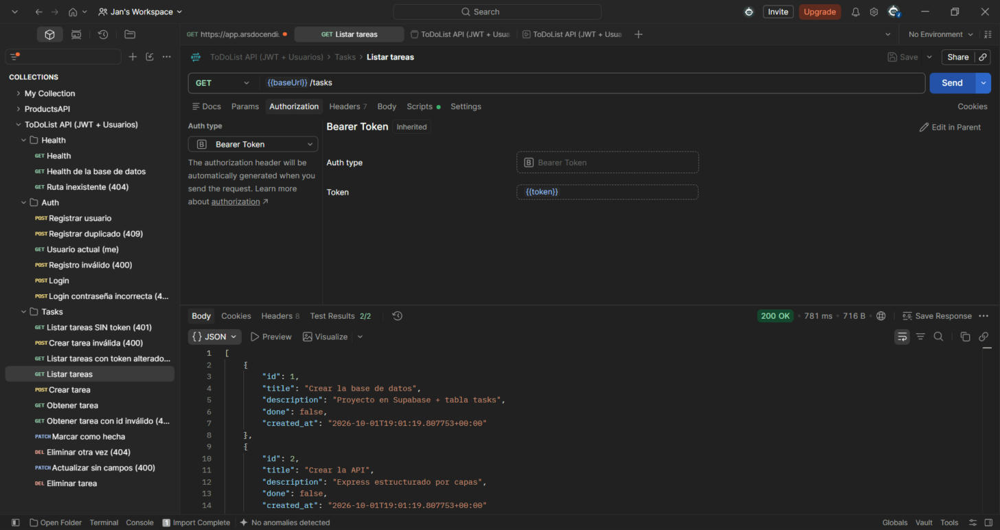

# ToDoListAPI — JWT + Usuarios

Tarea del curso **Diseño de Software** (ITCR, Ing. Jonathan Solís Parajeles): una Web API en Node.js (Express 5) organizada por capas que usa **Supabase** como base de datos, está documentada con **Swagger (OpenAPI 3.1)** y protegida con **autenticación JWT**.

Basada en el tutorial [`Semana 9/tasks-api`](https://github.com/JonathanSolisP/design-course/tree/main/Semana%209/tasks-api) del curso. El guion completo está en [TUTORIAL.md](./TUTORIAL.md). Esta entrega completa los **pasos 5, 6 y 7**:

| Paso | Tema | Tag de git |
|------|------|------------|
| 1–4  | Base de datos, proyecto Node, `/api/health`, primer GET a Supabase | `paso-4` |
| 5    | CRUD completo + validación con zod (400/404 consistentes) | `paso-5` |
| 6    | Documentación con Swagger en `/api/docs`, generada desde los schemas de zod | `paso-6` |
| 7    | Usuarios + JWT: `register`, `login`, `me` y `/api/tasks` protegida | `paso-7` |

> Para ver el código de un paso: `git checkout paso-N`.

## Requisitos

- Node.js 20.6 o superior (usa `--env-file` y `--watch`, así que no hacen falta `dotenv` ni `nodemon`)
- Un proyecto en [Supabase](https://supabase.com)

## Puesta en marcha

1. En Supabase → **SQL Editor**, ejecutar `supabase/01_tasks.sql` y luego `supabase/02_auth.sql`.
2. Copiar `.env.example` a `.env` y completar:
   - `SUPABASE_URL` y `SUPABASE_SECRET_KEY` (Project Settings → API Keys). La secret key solo se usa en el servidor.
   - `JWT_SECRET` (mínimo 32 caracteres). Generarlo con:
     ```bash
     node -e "console.log(require('crypto').randomBytes(48).toString('base64url'))"
     ```
   - `JWT_EXPIRES_IN` (por defecto `1h`).
3. Instalar y levantar:

```bash
npm install
npm run dev
```

4. Abrir **http://localhost:4000/api/docs** (Swagger UI) o probar con:
   - `requests.http` (extensión REST Client de VS Code): el token se toma solo del request `login`.
   - **Postman**: importar [`postman/ToDoListAPI.postman_collection.json`](./postman/ToDoListAPI.postman_collection.json) (o `http://localhost:4000/api/docs/openapi.json`). El request *Login* guarda el token en la variable `token` y toda la carpeta *Tasks* lo usa.



## Flujo de autenticación

```
1) POST /api/auth/register  { email, password }  ──►  guarda email + hash(bcrypt)
2) POST /api/auth/login     { email, password }  ──►  { accessToken: "eyJ..." }
3) GET  /api/tasks
   Authorization: Bearer eyJ...
        │
        ▼
   requireAuth ── sin token / firma inválida / expirado ──► 401
        │ ok → req.user = { id, email }
        ▼
   controller → service → repository   (sin cambios)
```

- La contraseña **nunca** se guarda: solo su hash de bcrypt (`$2b$10$...`).
- Login con usuario inexistente o contraseña incorrecta devuelve el mismo `401 Credenciales inválidas` (no da pistas).
- Para cerrar todo el módulo de tareas bastó **una línea** en `task.routes.js`: `taskRouter.use(requireAuth)`. El controller, service y repository de tareas no cambiaron.

## Estructura

```
src/
├── server.js                 # Arranca el servidor HTTP (solo eso)
├── app.js                    # Construye la app: middlewares, rutas y manejo de errores
├── routes.js                 # Monta los módulos bajo /api
├── config/env.js             # Lee y valida variables de entorno (zod)
├── lib/
│   ├── supabase.js           # Cliente de Supabase + unwrap()
│   └── jwt.js                # signToken / verifyToken (único que conoce jsonwebtoken)
├── middlewares/              # validate, auth (requireAuth), not-found, error-handler
├── utils/http-error.js       # Error con código HTTP (400, 401, 404, 409)
├── docs/
│   ├── helpers.js            # toSchema, jsonBody, jsonResponse, errorResponse, idParam, secure
│   ├── openapi.js            # Junta la documentación de los módulos (OpenAPI 3.1 + bearerAuth)
│   └── docs.routes.js        # /api/docs (Swagger UI) y /api/docs/openapi.json
└── modules/
    ├── health/               # GET /api/health, GET /api/health/db (+ health.docs.js)
    ├── auth/
    │   ├── auth.routes.js       # Rutas + composición de dependencias
    │   ├── auth.controller.js   # HTTP  ->  servicio
    │   ├── auth.service.js      # Registro (bcrypt) y login (JWT)
    │   ├── users.repository.js  # Acceso a la tabla users
    │   ├── auth.schema.js       # Credenciales (zod)
    │   └── auth.docs.js         # Documentación OpenAPI del módulo
    └── task/
        ├── task.routes.js       # Rutas + composición de dependencias + requireAuth
        ├── task.controller.js   # HTTP  ->  servicio
        ├── task.service.js      # Reglas de negocio
        ├── task.repository.js   # Acceso a datos (único que conoce Supabase)
        ├── task.schema.js       # Schemas zod: validan la entrada y generan la documentación
        └── task.docs.js         # Documentación OpenAPI del módulo
supabase/
├── 01_tasks.sql              # Tabla tasks + datos de ejemplo
└── 02_auth.sql               # Tabla users (email único + password_hash)
postman/
└── ToDoListAPI.postman_collection.json
```

## Endpoints

| Método | Ruta                  | Auth | Descripción                              |
|--------|-----------------------|------|------------------------------------------|
| GET    | `/api/health`         | —    | La API está viva                         |
| GET    | `/api/health/db`      | —    | La API llega a Supabase                  |
| GET    | `/api/docs`           | —    | Swagger UI                               |
| GET    | `/api/docs/openapi.json` | — | Documento OpenAPI 3.1                    |
| POST   | `/api/auth/register`  | —    | Registrar (`email`, `password` 8–72)     |
| POST   | `/api/auth/login`     | —    | Login → `{ accessToken, tokenType, expiresIn }` |
| GET    | `/api/auth/me`        | 🔒   | Usuario dueño del token                  |
| GET    | `/api/tasks`          | 🔒   | Listar tareas                            |
| GET    | `/api/tasks/:id`      | 🔒   | Obtener una tarea                        |
| POST   | `/api/tasks`          | 🔒   | Crear (`title`, `description?`, `done?`) |
| PATCH  | `/api/tasks/:id`      | 🔒   | Actualizar parcialmente                  |
| DELETE | `/api/tasks/:id`      | 🔒   | Eliminar                                 |

🔒 = requiere `Authorization: Bearer <token>`.

Errores siempre con la forma `{ "error": { "message": "...", "details": [...] } }`.

## Patrones usados

- **Layered:** routes → controller → service → repository.
- **Repository:** el acceso a datos queda aislado (`task.repository.js`, `users.repository.js`).
- **Factory + inyección de dependencias:** cada capa se crea con `createX(dependencia)`; el composition root está en cada `*.routes.js`.
- **Middleware / Chain of Responsibility:** `validate`, `requireAuth` y `errorHandler`.
- **Single source of truth:** los schemas de zod validan la entrada y generan la documentación Swagger.
